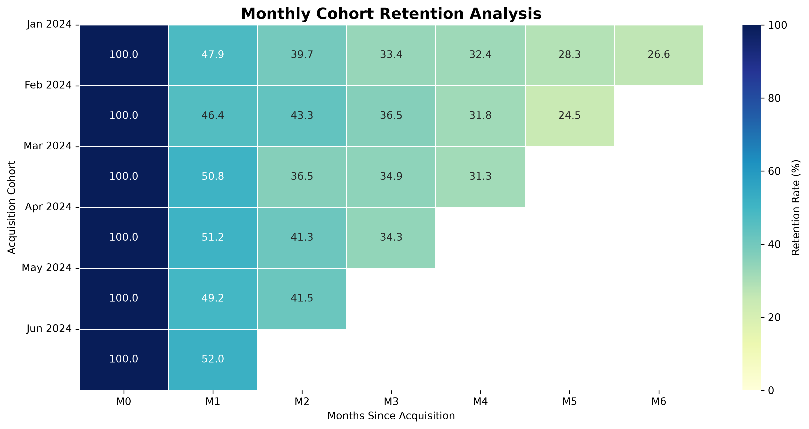

# A/B Testing & Product Analytics

**Analyst:** Neharika Mandhan  
**Project Type:** Product Analytics | Experimentation | Statistical Analysis  
**Status:** Completed

---

## 1. Executive Summary

This project evaluates a 50,000-user SaaS homepage A/B experiment to determine whether a redesigned homepage improves signup conversion without compromising revenue or creating friction across user segments.

The Variant achieved a statistically significant conversion improvement of **+0.37 percentage points (p = 0.015)**. However, the observed lift fell below the predefined Minimum Detectable Effect (MDE) of +0.50 percentage points.

More importantly, 30-day Average Revenue Per User (ARPU) declined by approximately **11.98% (p = 0.032)**. Device-level analysis also revealed negative conversion performance on Mobile, while the initial conversion improvement weakened during Week 2.

**Final Recommendation: DO NOT SHIP GLOBALLY. Proceed with a staged Desktop-only rollout while investigating revenue deterioration and remediating the Mobile experience.**

---

## 2. Business Problem

The product team introduced a redesigned SaaS homepage with the objective of improving user signup conversion.

The experiment aimed to answer four business questions:

1. Does the redesigned homepage improve signup conversion?
2. Does the conversion improvement meet the minimum commercially meaningful effect?
3. Does the redesign negatively affect revenue per user?
4. Are the results consistent across devices and over time?

The objective was not simply to identify a statistically significant winner, but to determine whether the treatment justified a broader product rollout.

---

## 3. Datasets

The project uses three datasets:

| Dataset | Description | Purpose |
|---|---|---|
| `clickstream_events.csv` | 26,061 clickstream events across 10,000 users | Funnel analysis and conversion drop-offs |
| `cohort_activity.csv` | Cohort activity records for 1,200 users across January–June 2024 | Cohort retention analysis |
| `homepage_ab_test.csv` | 50,000-user homepage experiment | A/B testing, revenue analysis and experiment diagnostics |

---

## 4. Methodology

### Milestone 1 — Project Setup & Data Preparation
- Established the GitHub repository and project structure.
- Organized datasets, notebooks and analytical findings.

### Milestone 2 — Conversion Funnel Analysis
- Examined the multi-step user journey from homepage visit to signup.
- Identified conversion drop-offs across product interaction stages.
- Compared overall and device-level conversion funnels.

**Overall funnel results:**

| Funnel Stage | Users |
|---|---:|
| Homepage | 10,000 |
| Product View | 6,731 |
| Add to Cart | 3,396 |
| Checkout Start | 1,633 |
| Signup Complete | 1,301 |

### Milestone 3 — Cohort Retention Analysis
- Grouped users into acquisition cohorts.
- Built cohort-based retention matrices.
- Analyzed engagement patterns over time.
- Visualized retention dynamics using a Seaborn heatmap.

### Milestone 4 — A/B Testing & Experiment Diagnostics
- Audited experiment allocation using a Sample Ratio Mismatch (SRM) chi-square test.
- Calculated conversion rates and confidence intervals.
- Performed a two-sample proportion Z-test.
- Evaluated the predefined Minimum Detectable Effect (MDE).
- Used Welch's two-sample t-test to evaluate 30-day ARPU.
- Conducted device-level analysis using logistic regression and interaction effects.
- Compared Week 1 and Week 2 conversion lifts to assess temporal stability.

### Milestone 5 — Executive Decision & Recommendations
- Consolidated analytical findings into an executive decision memo.
- Evaluated statistical significance against practical business impact.
- Developed rollout recommendations and mitigation experiments.

---

## 5. Key Findings

### 5.1 Signup Conversion

| Metric | Control | Variant |
|---|---:|---:|
| Users | 25,053 | 24,947 |
| Completed Signups | 712 | 802 |
| Conversion Rate | 2.8420% | 3.2148% |

**Absolute conversion lift:** +0.3728 percentage points  
**Statistical significance:** p = 0.014990  
**95% Confidence Interval:** [+0.0724 pp, +0.6733 pp]  
**Predefined MDE:** +0.50 percentage points

The Variant achieved a statistically significant conversion improvement. However, the observed lift reached only 74.56% of the predefined MDE.

**Business implication:** Statistical significance alone is insufficient to justify rollout when the observed improvement falls short of the required practical effect.

### 5.2 Revenue Guardrail

| Metric | Control | Variant |
|---|---:|---:|
| 30-Day Revenue | $83,011.10 | $72,753.34 |
| 30-Day ARPU | $3.3134 | $2.9163 |

**ARPU difference:** −$0.3971  
**Relative decline:** Approximately 11.98%  
**Welch's t-test p-value:** 0.032274

The Variant generated significantly lower revenue per user.

**Business implication:** The conversion improvement came at the expense of the revenue guardrail, making an unrestricted rollout commercially risky.

### 5.3 Device-Level Performance

| Metric | Desktop | Mobile |
|---|---:|---:|
| Control Conversion | 3.3936% | 2.2880% |
| Variant Conversion | 4.3083% | 2.1311% |
| Absolute Lift | +0.9147 pp | −0.1569 pp |

The device interaction test produced a statistically significant result (p = 0.003).

**Business implication:** The Variant performs positively on Desktop but negatively on Mobile. A global rollout would expose Mobile users to a treatment associated with lower conversion.

### 5.4 Temporal Stability

| Metric | Week 1 | Week 2 |
|---|---:|---:|
| Control Conversion | 2.9128% | 2.7723% |
| Variant Conversion | 3.3874% | 3.0443% |
| Absolute Lift | +0.4746 pp | +0.2720 pp |

Conversion lift declined by approximately 42.7% between the two weeks.

**Business implication:** The weakening improvement suggests possible novelty decay. A formal treatment-by-week interaction test is required to establish statistical significance.

### 5.5 Experiment Health

The Sample Ratio Mismatch test returned p = 0.6355, showing no evidence of significant allocation imbalance.

The experiment passed this allocation health check.

---

## 6. Visualizations

### Conversion Funnel Analysis

**Overall Conversion Funnel**

[View Interactive Overall Funnel](findings/02_overall_conversion_funnel.html)

**Device-Level Conversion Funnel**

[View Interactive Device Conversion Funnel](findings/02_device_conversion_funnel.html)

### Cohort Retention Analysis



*User retention patterns across acquisition cohorts and activity periods.*

---

## 7. Business Recommendations

Based on the combined conversion, revenue, device and temporal diagnostics, the recommended decision is:

**DO NOT SHIP GLOBALLY. STAGED DESKTOP ROLLOUT ONLY.**

Recommended actions:

| Team | Recommended Action |
|---|---|
| Product | Authorize a controlled Desktop-only rollout with a concurrent holdout |
| Growth | Monitor signup conversion and revenue guardrails |
| Engineering | Investigate Mobile responsiveness, usability and checkout friction |
| Design | Develop targeted Mobile remediation experiments |
| Analytics | Investigate ARPU deterioration and conduct a formal treatment-by-week interaction test |

### Rollout Conditions

- Maintain a concurrent control group during the Desktop rollout.
- Monitor conversion and 30-day revenue performance.
- Establish predefined rollback thresholds.
- Expand exposure only after sustained performance is demonstrated.
- Reconsider Mobile deployment only after remediation and further experimentation.

The experiment demonstrates why product decisions must account for both statistical significance and commercial impact.

---

## 8. Repository Structure

```text
ab-testing-product-analytics/
│
├── data/
│   ├── clickstream_events.csv
│   ├── cohort_activity.csv
│   └── homepage_ab_test.csv
│
├── findings/
│   ├── 02_funnel_friction.md
│   ├── 02_overall_conversion_funnel.html
│   ├── 02_device_conversion_funnel.html
│   ├── 03_retention_dynamics.md
│   ├── 03_cohort_retention_heatmap.png
│   ├── 04_experiment_diagnostics.md
│   └── 05_executive_decision_memo.md
│
├── notebooks/
│   ├── 02_funnel_analysis.ipynb
│   ├── 03_cohort_retention.ipynb
│   ├── 04_ab_test_evaluation.ipynb
│   └── ab_testing_product_analytics_master_notebook.ipynb
│
├── .gitignore
└── README.md
```

---

## 9. Tools & Technologies

- **Programming:** Python
- **Data Manipulation:** pandas, NumPy
- **Statistical Analysis:** SciPy, statsmodels
- **Data Visualization:** Matplotlib, Seaborn
- **Analysis Environment:** Jupyter Notebook
- **Version Control:** Git and GitHub

---

## 10. Project Conclusion

This project demonstrates an end-to-end product analytics workflow, from user funnel and cohort analysis to controlled experimentation and executive decision-making.

The key takeaway is that **a statistically significant conversion improvement does not automatically translate into a successful product experiment.**

Revenue guardrails, user-segment performance, practical effect sizes and temporal stability must all inform rollout decisions.

The recommended approach is to capture the positive Desktop response through a controlled rollout while addressing Mobile friction and investigating revenue deterioration before considering global deployment.