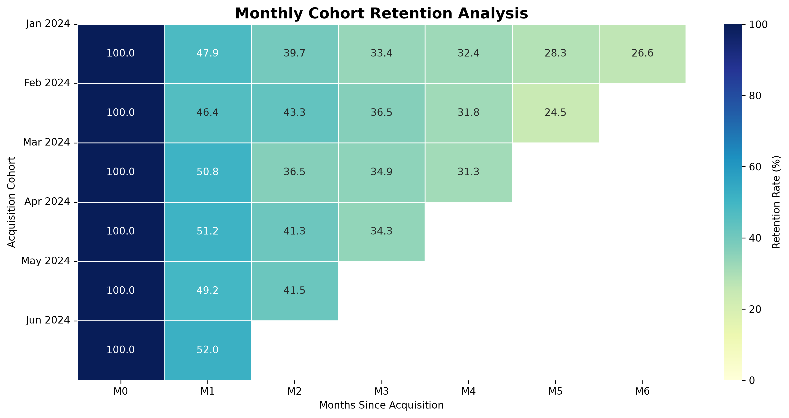

# Cohort Retention Dynamics Analysis

## Executive Summary

The cohort retention analysis examines monthly user activity across six acquisition cohorts from January to June 2024. The synthetic dataset contains 1,200 users and 3,016 activity records. Retention is measured as the percentage of each original acquisition cohort that remains active in subsequent months.

The overall pattern shows a steep initial decline followed by a progressively slower decrease. This indicates a **Leaky Bucket pattern with a flattening tail**: substantial early churn occurs, but a smaller group of users continues engaging over time.

## Cohort Retention Matrix

| Acquisition Cohort | M0 | M1 | M2 | M3 | M4 | M5 | M6 |
|---|---:|---:|---:|---:|---:|---:|---:|
| Jan 2024 | 100.00% | 47.93% | 39.66% | 33.45% | 32.41% | 28.28% | 26.55% |
| Feb 2024 | 100.00% | 46.35% | 43.35% | 36.48% | 31.76% | 24.46% | — |
| Mar 2024 | 100.00% | 50.79% | 36.51% | 34.92% | 31.35% | — | — |
| Apr 2024 | 100.00% | 51.16% | 41.28% | 34.30% | — | — | — |
| May 2024 | 100.00% | 49.23% | 41.54% | — | — | — | — |
| Jun 2024 | 100.00% | 52.03% | — | — | — | — | — |

## Retention Curve Assessment

**1. Curve Shape Classification**

The retention curve is best classified as a **Leaky Bucket with a flattening tail**. The initial loss is substantial, but the rate of decline slows in later months. This is not a Smiling curve because the data shows no evidence of retention recovery or reactivation. Although the later decline becomes smaller, the results do not establish product-market fit.

**2. M1 Drop-off and M3+ Behavior**

Across the six cohorts, M1 retention ranges from 46.35% to 52.03%. This means approximately half of acquired users do not return during the month following acquisition. This early drop-off suggests potential weaknesses in onboarding, initial product experience, or the communication of ongoing product value.

After M1, retention declines more gradually. The January cohort retains 33.45% at M3 and 26.55% at M6. This slower decline suggests that a smaller, more engaged group continues using the product. The M3–M6 pattern indicates gradual stabilization rather than a complete retention plateau.

**3. Strategic Recommendations**

- **Improve onboarding:** Simplify registration and first-use experiences, provide guided product tours, and help users reach their first meaningful outcome quickly.
- **Strengthen early engagement:** Introduce contextual reminders, personalized onboarding messages, and follow-up communication during the first 30 days.
- **Target mid-lifecycle users:** Use behavioral triggers to identify users whose activity is declining and deliver relevant feature education, reminders, or re-engagement campaigns around M2–M3.
- **Monitor cohort performance:** Track M1, M3, and M6 retention for future cohorts to evaluate whether interventions improve long-term engagement.

## Limitations

This analysis uses synthetically generated activity data with predefined retention probabilities. The observed retention pattern is useful for demonstrating cohort analysis techniques, but it does not represent actual customer behavior or independently establish product-market fit. Further validation with real product usage data is required.

## Conclusion

The analysis identifies significant early user drop-off followed by slower retention decline. Improving onboarding and introducing targeted mid-lifecycle engagement strategies are the primary opportunities to improve retention.